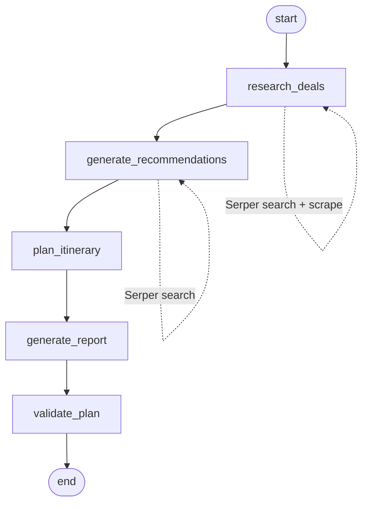

# Travel Agent

Repository created in July 2025. Reorganized and cleaned up in October 2026 (file structure and README only, the code is as it was written at the time, except where the README notes a fix).

A multi-agent travel planner. Given a structured trip request (origin, destination, dates, budget, interests, travel style), it searches the web for flight and hotel deals, picks a recommendation matched to the traveler, sketches a day-by-day itinerary, writes a short report with a cost estimate, and has a supervisor step check the result. The same five steps are implemented twice: once as a CrewAI hierarchical crew and once as a LangGraph state graph, behind one shared interface. A FastAPI server and a Streamlit form sit on top and can switch between the two backends with an environment variable. The model is Gemini 2.0 Flash through `langchain-google-genai`, and web search goes through Serper.

## Inputs and outputs

Both backends expose the same function:

```python
run_agentic_flow(trip_details: dict) -> {"result": str}
```

`trip_details` is a flat dict of strings. All fields are free text so dates like "November 2025" are fine.

| key | example |
|---|---|
| `origin` | `"New York"` |
| `destination` | `"Southeast Asia"` |
| `start_date` | `"November 2025"` |
| `end_date` | `"December 2025"` |
| `num_travelers` | `"1 (solo)"` |
| `budget_preference` | `"$2000-$3000 (excluding flights)"` |
| `interests` | `"vibrant cultures, local food, hiking, snorkeling"` |
| `travel_style` | `"adventurous"` |
| `natural_language_request` | the traveler's request in their own words |
| `user_preferences` | a stringified dict of past destinations, activity types, dietary restrictions and so on |

The result is a markdown string. The FastAPI route returns `{"result": ..., "backend": ...}`. `examples/demo_request.py` holds the demo request used by the CLI.

## Architecture

Five steps run in the same order in both backends:

1. research deals (search, optionally scrape the top hit, pick one flight and one hotel)
2. generate recommendations (search, suggest one destination or activity)
3. plan itinerary (3-day bullet sketch)
4. generate report (short summary with total budget)
5. validate plan (supervisor returns `READY` or `NEEDS EDIT: <reason>`)

### CrewAI backend (`crewai_version/`)

Five agents (supervisor, deal finder, recommendation expert, travel planner, itinerary finalizer) and five tasks, run with `Process.hierarchical`. The supervisor's LLM acts as the manager: it assigns each task to an agent, passes context between tasks, and can ask an agent to redo work. Tool use (Serper search, website scraping) is chosen by the agents themselves during their ReAct loop.

### LangGraph backend (`langgraph_version/`)

A `StateGraph` over a `TypedDict` state with the fields `trip_details`, `deals`, `recommendations`, `itinerary`, `report` and `validation`. Each node reads the fields it needs, makes one Gemini call with a prompt adapted from the CrewAI task description, and writes one field back. Search and scrape are plain function calls made before the prompt, not model-selected tools.



### Where the delegation went

In the CrewAI version the manager decides which agent runs which task and what context it receives, so the exact call sequence and the number of LLM calls vary from run to run. In the LangGraph version that control flow is written down as edges: the order is fixed, each node makes exactly one model call, and context passing is explicit (each prompt template names the upstream fields it includes). The supervisor is reduced to the final `validate_plan` node, and the agent roles become system prompts in `langgraph_version/prompts.py`. The trade is flexibility for predictability: the graph is easier to debug and cheaper to run, and the crew can recover from a bad intermediate result by re-delegating.

One output difference: `Crew.kickoff` returns the final task's output as produced by the manager, while the LangGraph runner concatenates all five node outputs into one markdown document with a Status line at the end.

## Repo layout

```
.
├── run.py                   CLI entry point, --backend crewai|langgraph
├── app.py                   FastAPI app
├── api/                     routes and request schema
├── streamlit_app.py         Streamlit form
├── settings.py              env loading and backend selection
├── check_env.py             prints which API keys are set
├── crewai_version/
│   ├── agents.py            five agents sharing one Gemini model
│   ├── tasks.py             five tasks with {placeholders} filled from trip_details
│   ├── main.py              builds the hierarchical crew, run_agentic_flow()
│   └── archive/             original long-form prompts and the script-style main
├── langgraph_version/
│   ├── graph.py             state TypedDict, five node functions, build_graph()
│   ├── prompts.py           prompt templates lifted from tasks.py
│   ├── tools.py             Serper search and page scrape helpers
│   └── run.py               run_agentic_flow() for this backend
├── examples/
│   ├── demo_request.py      the demo trip_details
│   ├── sample_output_1.md   a full report from an earlier run
│   └── sample_output_full.md a longer run including search results
├── notebooks/playground.ipynb
├── requirements.txt         direct dependencies, loose pins
├── requirements-lock.txt    the full pinned environment the project was built in
├── Dockerfile
└── render.yaml
```

Verbose agent logs (`agent_thoughts.md`), `.env` files and `__pycache__` are gitignored.

## Setup

Python 3.11 (see `.python-version`).

```bash
python -m venv .venv && source .venv/bin/activate
pip install -r requirements.txt
cp .env.example .env     # then fill in the keys
python check_env.py      # confirms which keys are set
```

Keys used: `GOOGLE_API_KEY` (Gemini) and `SERPER_API_KEY` (search) are required. `FIRECRAWL_API_KEY` and `GROQ_API_KEY` are listed for completeness from earlier experiments and are not used by the current code.

Optional settings: `AGENT_BACKEND=crewai|langgraph` (default `crewai`), `GEMINI_MODEL` (default `gemini-2.0-flash`), `MAX_OUTPUT_TOKENS` (default 256, raise it for longer reports), `SCRAPE_TOP_RESULT=0` to skip scraping in the LangGraph deals node.

## How to run

CLI, with the demo request or a JSON file of `trip_details`:

```bash
python run.py --backend crewai
python run.py --backend langgraph
python run.py --backend langgraph --request my_trip.json
```

FastAPI:

```bash
uvicorn app:app --reload
curl -X POST localhost:8000/plan-trip \
  -H "Content-Type: application/json" \
  -d '{"backend": "langgraph", "trip_details": {"origin": "New York", "destination": "Lisbon", "start_date": "May 2026", "end_date": "May 2026", "num_travelers": "2", "budget_preference": "$3000", "interests": "food, architecture", "travel_style": "relaxed", "natural_language_request": "A relaxed week in Lisbon.", "user_preferences": "{}"}}'
```

`backend` in the request body is optional and overrides `AGENT_BACKEND`. `GET /` reports the active default backend.

Streamlit (talks to the API at `API_URL`, default `http://localhost:8000`; set `CALL_BACKEND_DIRECTLY=1` to run the agent in-process without the API):

```bash
streamlit run streamlit_app.py
```

Docker:

```bash
docker build -t travel-agent .
docker run --env-file .env -e AGENT_BACKEND=langgraph -p 8000:8000 travel-agent
```

Render: `render.yaml` defines a free web service running the FastAPI app. Set the API keys in the Render dashboard; they are marked `sync: false` so they are never read from the repo.

## Example output

See [examples/sample_output_1.md](examples/sample_output_1.md) for a full report from the CrewAI backend, and [examples/sample_output_full.md](examples/sample_output_full.md) for a longer run that includes the raw search results the agents saw. Both were produced with the long-form prompts now kept in `crewai_version/archive/`; the current prompts are shortened and capped at 256 output tokens to keep runs fast and within free-tier quota.

## Notes

- The Gemini free tier rate-limits quickly. Both backends catch exceptions from the run and return a fixed fallback message instead of failing the HTTP request.
- `requirements-lock.txt` is the original fully pinned environment (CrewAI 0.30, LangChain 0.1). The LangGraph backend needs newer `langchain-core` and `langgraph` than that lock file contains, so install from `requirements.txt`.
